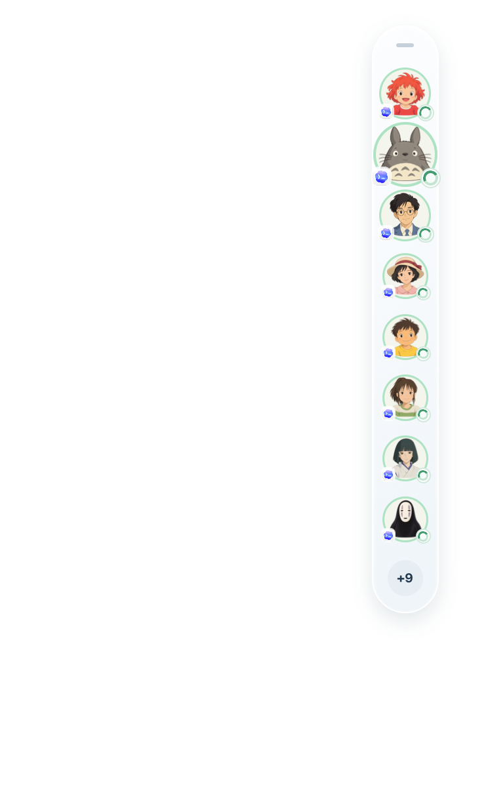
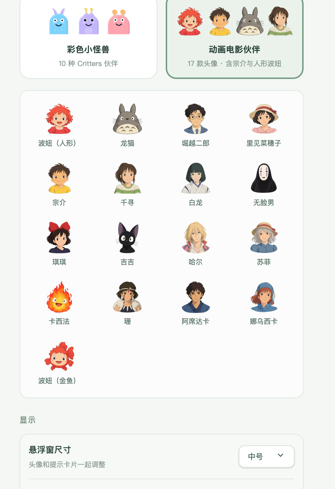

# 桌面伙伴：距离放大、清晰绘制与本地头像主题

本次改动集中在悬浮栏的视觉与交互，不改变 Agent 来源、监听或会话跳转逻辑。

## 使用效果

鼠标靠近头像时，最近的伙伴最多放大到 1.4 倍，相邻头像轻微放大；移开后平滑恢复。头像的布局位置保持稳定，放大的外沿仍可点击。此效果适用于小号、中号和标准尺寸，也适用于没有任务时的休眠伙伴。



设置中增加两种可选主题：

- **彩色小怪兽**：10 款 DiceBear Critters，本地 SVG 素材，包含状态表情、视线与轻摇。
- **动画电影伙伴**：17 款透明 PNG，包含 16 位电影角色，以及波妞的人形和金鱼两种形态。角色面部保持原图造型，配合整体动作和状态标记显示。



## 实现要点

### 按实际显示尺寸绘制

头像按钮保留固定的布局尺寸，内部 `.desktop-avatar-visual` 按放大后的尺寸绘制。SVG、PNG、来源标记和状态环同步调整实际宽高，避免把小尺寸缓存图层直接拉大。PNG 保留 1254 × 1254 原图；SVG 继续使用矢量图形。

### 距离驱动的放大

`dock-magnification.ts` 使用有界的余弦距离函数和时间插值。中心位置来自未变形的布局坐标，避免放大后的尺寸反过来影响鼠标距离。动画只在几何变化时继续请求帧，不通过 React 状态逐帧更新。

鼠标拖动、触摸输入、失去焦点、打开右键菜单及进入提示卡时会恢复头像大小。关闭应用动画或启用系统减少动态效果时停用放大。

### 原生点击区域

点击区域注册在实际绘制表面上，在尺寸变化时同步到原生窗口，确保放大的头像外沿能响应点击。按钮禁用、隐藏或离场时不注册可点击区域。

### 按主题数量分配头像

会话模型根据主题的实际款数分配头像，修复不同缓存编号取余后指向同一角色的问题。在款数足够时优先分配不同头像；超过款数时均衡复用。已有编号在会话更新和重启时保持稳定，切换主题数量时重新校准。

## 验证方式

使用仓库现有检查流程：

```sh
npm ci
npm run ci:web
cargo test -p agent-studio-core -p agent-studio-runtime --locked
```

macOS 原生验证使用诊断构建，在独立运行目录内创建 17 个测试会话：

```sh
npm run desktop:prepare
npm exec tauri -- build --bundles app --features diagnostics --config '{"identifier":"com.agentcompanion.communityqa","bundle":{"createUpdaterArtifacts":false}}'
AGENT_COMPANION_QA_DOCK=1 node scripts/qa-native-app.mjs
```

测试构建使用独立应用标识，避免与已运行的应用争用同一个实例。原生检查覆盖 4 种主题 × 3 种尺寸、布局稳定、清晰绘制尺寸、头像外沿点击、滚动与动画开关。测试使用临时偏好事件，不保存用户偏好。检查系统减少动态效果的停用行为由实现及样式保证；原生动画检查需要该系统选项关闭。

`hit_regions_snapshot` 只在诊断功能启用时提供只读验证数据，不作为应用 IPC 命令公开。

### 本次验证结果

- `npm run ci:web`：类型、代码规范、测试、构建及资源包检查通过。
- 指定原生运行时后，187 项 JS 测试全部通过，0 项跳过。
- `cargo test --workspace --locked`：151 项 Rust 测试通过。
- Rust / Node 会话模型一致性检查通过。
- macOS / Retina 原生窗口的 27 项交互检查通过，12 种主题与尺寸组合全部通过。
- 实测头像绘制宽度由 31.1875 CSS px 增至 43.640625 CSS px，设备像素比为 2；布局锚点不变，17 款头像分配唯一。

原生检查摘要保存在 [validation.json](../assets/desktop-companions/validation.json)。运行完整 JS 测试时可指定 `CODEG_RUNTIME_BINARY="$PWD/target/release/agent-studio-runtime" npm test`。已有 Codeg 测试模拟补充了上游启动时查询连接列表的空响应。

## 素材与范围

- Critters 随应用打包，采用 CC0 1.0；见[来源说明](../public/licenses/critters.md)。
- 电影角色头像为 AI 生成的非官方同人插画；见[生成与来源说明](../public/licenses/cinema.md)。
- 当前原生交互主要在 macOS / Retina 显示上验证。Windows 和 Linux 的相同交互尚未完成原生验证。
- 本次没有更改默认主题，也没有增加运行时图片请求或头像服务依赖。
